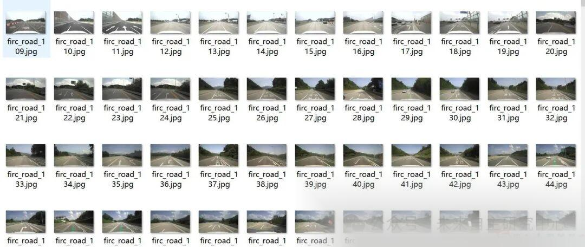
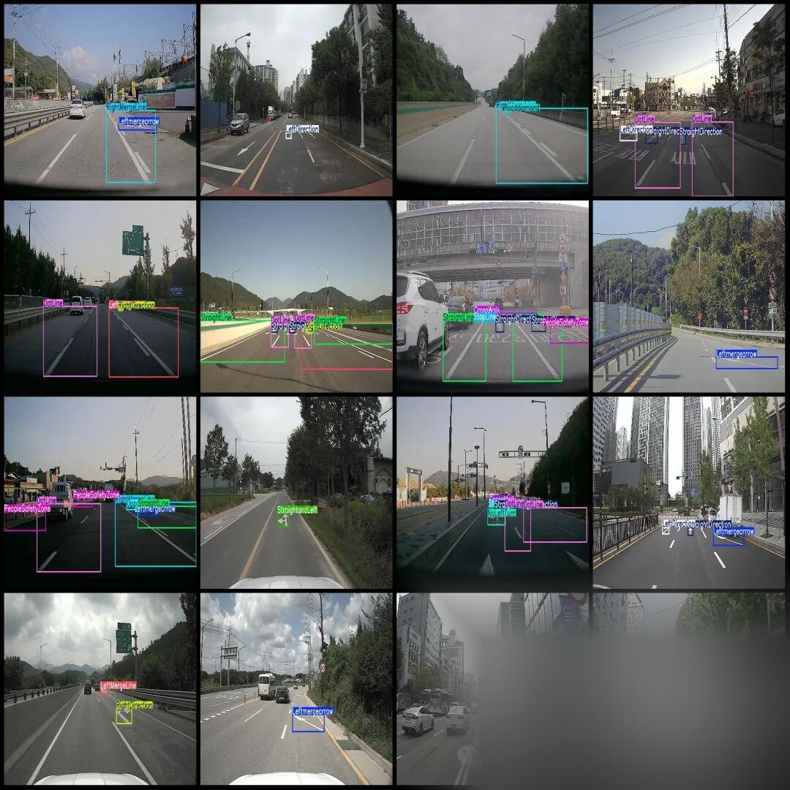

# Intelligent Transportation - Road Lane Line Detection Dataset VOC+YOLO format with 1783 images and 44 categories

Dataset format: Pascal VOC format + YOLO format (txt file without split path, only containing jpg images and corresponding VOC format xml files and yolo format txt files)

Number of images (number of jpg files): 1783

Number of annotations (number of xml files): 1783

Number of annotations (number of txt files): 1783

Labeling category count: 44

Label categories (Note that the order of yolo format categories does not correspond to this, but is based on the labels folder's classes.txt): ["BusLine", "Busstopzone", "CenterLine", "Colorcone", "ConstructionZone", "Constructionleftmergearrow", "CrossWalk", "DotLine", "LeftDirection", "LeftMergeLine", "LeftandRight", "LeftandUturn", "Leftmergearrow", "NoLeftTurn", "NoRightTurn", "NoStraight", "Nouturn", "OppositeSideLeft", "OppositeSideUturn", "OppositeTriangle", "PeopleSafetyZone", "RightDirection", "RightMergeLine", "Rightmergearrow", "Roaddiamond", "SpeedLimit50", "Speedlimit30", "Speedlimit40", "Speedlimit50", "Speedlimit80", "Speedlimit90", "StopLine", "StraightDirection", "StraightLeftRight", "StraightLine", "StraightandLeft", "StraightandRight", "SuddenlyDotLine", "TurnDirection", "TurnDotLine", "Uturn", "bikeroad", "speedlimit60", "speedlimit70"]

Number of boxes labeled in each category:

BusLine Frame Count = 19

Busstopzone Frame Count = 7

CenterLine Frames = 380

Colorcone frame count = 83

ConstructionZone Frame Count = 6

Constructionleftmergearrow Frame Count = 1

CrossWalk Frames = 190

DotLine Frames = 1287

LeftDirection Frames = 283

LeftMergeLine Frames = 258

Left and Right Frames = 3

LeftandUturn Frames = 36

Leftmergearrow Frames = 196

NoLeftTurn Frames = 53

NoRightTurn Frames = 36

NoStraight Frames = 152

Nouturn Frames = 20

OppositeSideLeft Frame Count = 27

OppositeSideUturn Frames = 13

OppositeTriangle Frame Count = 97

PeopleSafetyZone Frames = 259

RightDirection Frames = 437

RightMergeLine Frames = 146

Rightmergearrow Frames = 59

Roaddiamond frame count = 162

SpeedLimit50 Frames = 1

Speed limit 30 = 77

Speed limit 40 = 24

Speed limit 50 = 39

Speed limit 80 = 40

Speed limit 90 = 9

StopLine Frames = 188

StraightDirection Frames = 900

StraightLeftRight box count = 1

StraightLine Frame Count = 964

StraightandLeft Frame Count = 120

StraightandRight Frames = 141

Suddenly, DotLine Frames = 18

TurnDirection Frames = 11

TurnDotLine Frames = 46

Turn Frames = 44

bikeroad frame count = 7

Speed limit 60 = 21

Speed limit 70 = 17

Total frame count: 6878

Using labelImg:

Annotation rules: Draw a rectangle around the category.

Important Notice: No

Special : This dataset does not guarantee the accuracy or precision of the trained models or weight files. The dataset is provided with accurate and reasonable annotations only.

Image Preview:

Annotation example:

## Payment

Here is a pay link on Stripe ( https://buy.stripe.com/3cs8yP7sY87d0vu9AB ). Please contact me lonlonago@foxmail.com after funding $89, and I will send you a complete data files , thank you!

